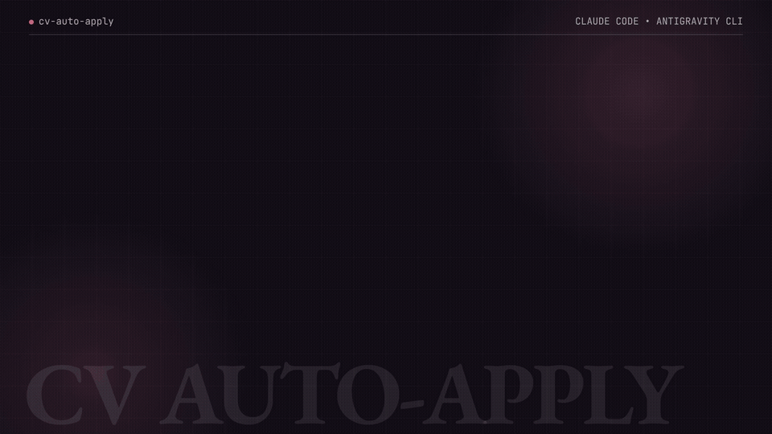

# cv-auto-apply

AI job-hunting & CV-tailoring plugin built on top of two battle-tested open-source repositories (**135,000+ combined GitHub stars**):

- **[career-ops-hq/career-ops](https://github.com/career-ops-hq/career-ops) (83.1k★)** — ATS scoring, fact-verification, Story-Memory HTML tailoring & strict 1-page A4 PDF export.
- **[vercel-labs/agent-browser](https://github.com/vercel-labs/agent-browser) (52.1k★)** — Stealth headless job discovery & multi-tab `--headed` form pre-fill.



> [Watch full 1080p silent demo (MP4)](assets/demo.mp4)

## Architecture

```text
Your GitHub + Experience ──▶ fetch-github-summary.mjs ──▶ career-ops (83.1k★)
                                                               │ (ATS + Fact + 1-Page PDF)
ITviec / Job Portals     ◀── agent-browser (52.1k★)   ◀── cv-quality-gate.mjs
                             (Pre-fills PDF & Letter, stops at Submit)
```

## Install

**Claude Code**
```text
/plugin marketplace add nhien36hk/cv-apply-agent
/plugin install cv-auto-apply@cv-apply-agent
```

**Antigravity CLI (`agy`)**
```bash
git clone https://github.com/nhien36hk/cv-apply-agent.git /tmp/cv-apply-agent && agy plugin install /tmp/cv-apply-agent
```

**Universal Skills CLI**
```bash
npx skills add nhien36hk/cv-apply-agent
```

## Usage

After installing, prompt your agent naturally:

```text
Read the cv-auto-apply skill and help me find matching jobs, tailor 1-page ATS CVs, and pre-fill the application forms.
```

## Guarantees

1. **Zero Fabrication:** Every CV metric and cover letter claim is verified against `cv.md` and mined GitHub repos (`verify-cv-facts.mjs` + `cv-quality-gate.mjs`).
2. **International ATS Standards:** Enforces ATS score >= 70 (91/100 Grade A in demo), keyword coverage, and strict 1-page A4 layout per role.
3. **Human-in-the-Loop Safety:** Pre-fills 5–10 tabs automatically and always stops before `Send my CV` (never bypasses CAPTCHA/Turnstile).
